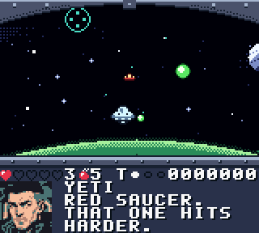
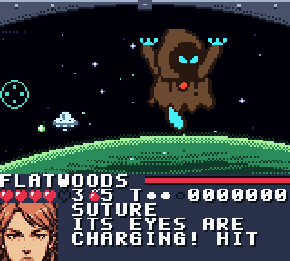
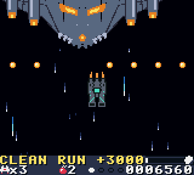
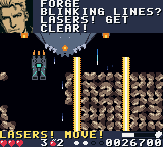
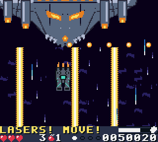
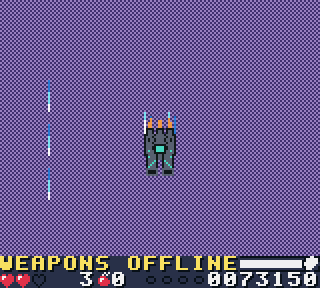

# Sneaky Kryptid: Kryptids in Space — Game Boy Color demo

A vertical space shooter for the Game Boy Color. You fly the Sneaky Kryptid, a bounty-hunter
ship, on five cryptid contracts: the Space Kraken, the Thunderbird, the Jersey Devil, the
Wendigo and the Flatwoods Monster. Fly clean and score high to bring the bounty in alive.
Then a rival gang shows up, the guns go dead, and the sixth mission is a run for your life.

**Demo v1.2 (branch `escape-run`).** Six missions (four scrolling stages, a first-person gun-cam
mission and a no-guns escape run), three difficulties, saves, upgrades. Runs on real hardware
(tested on a ModRetro Chromatic; original GBC and GBA hardware should work too) and any Game Boy Color emulator.

A game by Anthony DeGeorge · **Rejected By The Machines** · Kryptids in Space / Kryptid Prime Empire.

  
  
 
   

## Play it
**New: Flatwoods Drift, the gun-cam demo.** Mission 5 on its own: Rejected By The Machines card, title, pick a
pilot, fly it. Play in the browser at https://ant-degeorge.github.io/SneakyKryptids-KryptidsinSpace/flatwoods/
or flash `rom/flatwoods_drift.gbc` (`rom/flatwoods_drift_nosave.gbc` for carts without save RAM).
It keeps its own save (signature `SKF` at 0xA400), so it never touches a Sneaky Kryptid save.

**The full game:**
- **In your browser:** https://ant-degeorge.github.io/SneakyKryptids-KryptidsinSpace/play/ (touch controls on phones,
  keyboard on desktop; progress saves in that browser).
- Download `sneaky_kryptid.gbc` from the [Releases](../../releases) page, or from `rom/` in this repo.
- Emulator: SameBoy, Emulicious, BGB or mGBA in Game Boy Color mode.
- Hardware: any flash cart that takes a 512 KB MBC5 ROM. Use `sneaky_kryptid_nosave.gbc` if
  your cart has no save RAM.

The game opens with the Rejected By The Machines studio card (A or START skips it).

**Version:** Demo v1.2 on this branch (shown on the title screen); the public release is still v1.1.

### Saves
- Progress saves to the cart automatically: three slots (CADET, PILOT, HUNTER) with missions,
  stars, high scores, credits and gear.
- **Erase all saves:** on the title screen hold **SELECT** and press **B**, then **A** to confirm.
- The demo uses its own save block (signature `SKD`, version 4). Older saves (v1.0, v1.1 and the
  weapon-rune builds) are upgraded the first time this build boots: everything is kept and the
  new mission starts empty. The Flatwoods demo's block (`SKF`) is upgraded the same way. Saves left on a
  cart by other builds of the game are ignored and left untouched.

## Pilots
Studio card → title → WHO'S FLYING? → mission map → briefing → mission → debrief.
Three save slots, one per difficulty: CADET (easy), PILOT (medium) and HUNTER (hard).
Each keeps its own missions, stars, high scores, credits and gear.

| | CADET (easy) | PILOT (medium) | HUNTER (hard) |
|---|---|---|---|
| Health | 5 hearts, 3 lives | 3 hearts, 3 lives | one hit = one life, 3 lives |
| Firing | automatic | automatic | hold A |
| Bombs | 5 | 5 | 3 |
| Bullets | slower, fewer, plus one slow aimed shot every ~2.5 s | as Cadet, plus a faster aimed shot every ~1.25 s | aimed bursts, rings, fans |
| Continues | unlimited ("TRY AGAIN!") | unlimited ("TRY AGAIN!") | 9-second prompt, score resets |
| Boss HP | Kraken 420, Thunderbird 560, Jersey Devil 620, Wendigo 680, Flatwoods 800 | same as Cadet (Flatwoods 900) | 820 / 1150 / 1250 / 1350 / 720, extra phases |
| Rating | 1-5 stars by hits | 1-5 stars by hits | rank D/C/B/A/S by score |

All modes: you blink and can't be hit for a moment after respawning; the cockpit's bright dot
is your hitbox; losing your last life shows GAME OVER before the continue / try-again prompt;
mid-wave radio chatter waits (up to 4 s) for the top of the screen to clear; locked missions
show their name greyed out with a lock icon.

## Controls
- D-pad: fly
- A: fire (Hunter; Cadet and Pilot fire by themselves)
- B: Kryptid Bomb (clears bullets, damages everything)
- START: pause
- Mission map: UP/DOWN picks an unlocked mission, A launches. **Hold SELECT while pressing A** to practice that mission's boss.
- Cutscenes: A next line, B or START skips
- Mission 5 (gun cam): D-pad moves the crosshair, A fires (Hunter; Cadet and Pilot fire by themselves), B bomb
- Mission 6 (escape run): D-pad flies, **A dashes** when the BOOST meter is full, **B is the shield pulse** (your bomb stock)

## Bounties: capture, kill or escape
Your score in the mission decides how the boss fight ends:
- **CAPTURED** (top score): Forge's rune net seals it in the hold. Triple pay.
- **KILLED** (good score): contract closed. Double pay.
- **ESCAPED** (low score): it breaks away. Base pay only.
Mid-bosses work the same way (captured or destroyed if you beat them, gone if the timer runs out).
Continues cost you: Hunter's bounty points reset, Cadet's and Pilot's are halved.
Bonus pay: +50 for a captured mid-boss (+25 destroyed), +50 for a no-hit mission.

## Mission 5: the gun cam
Flatwoods Drift is a change of pace: the Monster's saucers jam the helm, so Static flies and you
work the cannons from the cockpit.
- The D-pad moves a crosshair (it speeds up while held). Shots land instantly where it points;
  the crosshair turns gold when something is under it.
- You cannot dodge. Green orbs fired at the ship grow as they close in and blink just before
  they land: shoot them down first. Rocks that flash red are on a collision course.
- Red saucers take more hits and fire pairs. Shoot capsules to collect them: the weapon capsule
  cycles T / S / H like the other missions (same letter = level up), or B bomb, heart or 1UP.
  In the gun cam S bursts splash nearby targets and H wisps lock on from further away.
- The dashboard shows the bounty meter and the outcome the run is heading for
  (ESCAPE, KILL or CAPTURE), so you can see what a missed wave costs.
- **Flatwoods Monster:** orb volleys, saucer escorts and big orbs (three hits, one with Rune
  Rounds). When its eyes flare it is charging a beam: land enough hits before the charge ends
  to stagger it, or take the hit.
- Lives, hearts, bombs, continues and gear work as in the other missions. Buddy Bay level 2
  puts a buddy on the second gun, who picks off an orb now and then. No mid-boss here.
- Checkpoints: start, debris field, the swarm, the boss.

## Mission 6: the escape run
Nubs is back with his whole gang and their flagship, the Scrapjaw. An EMP kills the cannons, so
there is no shooting in this mission at all: you run for the planet below and dodge everything.
- The ship points **down** the screen and the Scrapjaw chases from the top, sliding in and out.
  The bar on the right of the status line is the distance left to the planet.
- **Graze for BOOST.** A shot or missile that passes close without hitting fills the four BOOST
  pips (and scores). When they are full the HUD shows an A: press **A** to dash in the direction
  you hold, passing through anything for a moment. On Cadet a full meter also dodges a hit by itself.
- **B: shield pulse.** Uses the bomb stock; clears nearby shots and missiles.
- **Three phases.** The chase: bullet curtains with a gap, aimed fans, homing missiles (turn hard
  and they overshoot) and loose rocks. The gauntlet: asteroid walls with gaps (arrows at the bottom
  mark the next gap) and laser columns. The dive: everything at once, faster, through the upper
  atmosphere, until the Scrapjaw has to pull up.
- **Warnings come first.** A laser shows a thin blinking line and a marker for about a second
  before the beam fires, and it never takes the middle of a gap. Rocks get a marker at the bottom
  edge before they arrive.
- **Score** comes from distance, grazes, dashes and a +3000 bonus for every section flown without
  a scratch, so stars and ranks work as in the other missions.
- **The steal.** Fly well enough and the Scrapjaw's brig pod tears loose near the end: grab it.
  That counts as the capture (triple pay) and changes the debrief. Miss it, or score too low for it
  to appear, and you simply got away (base pay).
- Checkpoints: the chase, the gauntlet, the dive. SELECT+A on the map starts at the dive.
- Accessibility: hazards are always warm and bright (white, yellow, orange) and your side is cool
  (cyan, blue), so nothing depends on telling red from green; warnings have a shape and a blink as
  well as a colour; the screen never strobes (the ending is a slow haze fade).

## Shooting bullets
Your shots knock small enemy bullets out of the air (+10 each). Big orbs soak shots unless
you own Rune Rounds, which break them in two hits.

## Forge's Armory (START on the mission map)
Credits are saved per pilot. Gear stays bought.
| Item | Lv 1 | Lv 2 | Cost |
|---|---|---|---|
| Hull Plating | +1 life | +1 more | 150 / 350 |
| Cannon Tune | start at weapon level 2 | level 3 | 120 / 300 |
| Bomb Rack | +1 bomb | +1 more | 80 / 200 |
| Buddy Bay | room for 3 buddies | start with one | 200 / 400 |
| Rune Rounds | shots break big orbs | | 300 |

Press LEFT/RIGHT for the second tab, **Weapon Runes**. Each one wakes up when that weapon is at
max level (3 pips):
| Rune | What it does | Cost |
|---|---|---|
| Lance Rune | Twin's centre shot becomes a lance that pierces every enemy and small bullet in its path | 250 |
| Ricochet Rune | Spread's outer stars bounce off the side walls once | 250 |
| Chain Rune | a Homing wisp that hits jumps on to the nearest other enemy | 300 |

## Buddies
Each mission has a sleeping baby cryptid: kraken spawn, impundulu chick, pukwudgie, tatzelwurm pup.
Fly into it and it joins as a wingman that copies your moves and fires with you (up to 2, 3 with
the Buddy Bay). You lose one when you lose a life.

## Weapons
Capsules cycle T → S → H; grab the letter you want. Same letter again = level up (3 pips).
- **T** Twin cannons (L3 adds the prong cannons)
- **S** Spread (3 → 5 way)
- **H** Homing wisps (1 → 3)
- **B** bomb, **heart** (Cadet), **1** extra life (Hunter). Hunter extends at 30k and 80k.

Weapon flair: each weapon has its own colours (the exhaust burns in them too), muzzle flash and
impact (sparks, star bursts, frost puffs). The ship kicks when it fires and flashes when it
changes weapon, and the weapon's name pops up over the score. Kills throw shards, buddies fire
their own shots (ink, bolts, arrows, frost), capsules spin and glint, and the bomb is Forge's
rune circle.

## Missions
1. **Rimeveil Lane**: krakenlings (mini Krakens), gremlin skiffs, ice ring, mid-boss Nubs' scrap gunship, hauler convoy, wrecks → **Space Kraken** (a blinking marker shows tentacle slams).
2. **Stormwall Nebula**: Impundulu lightning birds, Lindworms (hit the head), thunderclouds that drop lightning columns, mid-boss **Mothman** → **Thunderbird** (bolts, feather fans, wind gusts, serpent summons, charge).
3. **Barrens Belt**: Pukwudgies (some climb out of the pines below; a WARN blinks first), Devil's eggs that burst, will-o'-the-wisps (shoot when lit), mid-boss **Nubs Mk II** → **Jersey Devil** (fire sweep, stomp rows with a gap, screech rings, vanish).
4. **Frostbite Moon**: bolted-down mine turrets, frost bats, Tatzelwurms (hit the cat face), ice-storm wind, mid-boss **Beast of Bray Road** (leaps between perches) → **Wendigo** (claw grabs with a marker, ice shard fans, howl rings with whiteout, bat summons, blizzard).

5. **Flatwoods Drift** (gun cam): scout saucers, a debris field, the swarm → **Flatwoods Monster** (orb volleys, escorts, big orbs, the eye beam you break by shooting it).
6. **Escape Run** (no guns): the chase, the asteroid gauntlet, the dive → outrun **Nubs's gang** and, on a good run, steal their brig pod.

Creature art is redrawn from the KRYPTID-DEX sheets (ref/dex).

Every mission has checkpoints at the start, the mid-boss and the boss approach.
Clearing a mission unlocks the next; clearing mission 6 plays the ending (career tally, the crew's verdict on your flying, and something watching).

## Story / crew
Crew: YETI (captain), FORGE (armorer, rune master), SUTURE (medic), ZANNAH (contract mistress), STATIC (navigator/pilot). GRAUL, a werewolf bounty hunter, turns up in mission 6's best debrief. Names live in `tools/gen_script.py`.
Edit there, then `python3 tools/gen_script.py` and rebuild.

## Building
Needs [GBDK-2020](https://github.com/gbdk-2020/gbdk-2020) 4.5.0. The generated sources
(art, music, dialog) are committed, so Python is only needed to change them.
- Linux/macOS/WSL: `make GBDK_HOME=/path/to/gbdk` → every ROM: `build/sneaky_kryptid.gbc`, `_nosave`, `_unlocked` and the two Flatwoods demo ROMs
- Windows: `build.bat` (expects GBDK at `C:\gbdk`, or set `GBDK_HOME`)
- `make flatwoods` → `build/flatwoods_drift.gbc` and `build/flatwoods_drift_nosave.gbc`, the standalone gun-cam demo
  (same sources built with `-DFLATWOODS_DEMO`: no mission map or armory, cart title FLATWOODS).
- `make unlocked` → `build/sneaky_kryptid_unlocked.gbc`, a test build with every mission selectable from the
  start (title shows DEMO V1.2 UNLOCKED; same save format).
- Do not build with `make -j`: lcc keeps its intermediate files side by side and parallel jobs
  produce broken objects (the Makefile sets `.NOTPARALLEL`).
- Regenerate data: `make script` (dialog, `tools/gen_script.py`), `make music` (`tools/gen_sound.py`),
  `make cockpit` (mission 5 art, `tools/gen_cockpit.py`, Python 3 + Pillow + numpy),
  `make escape` (mission 6 art and Graul's portraits, `tools/gen_escape.py`, same needs; reads `ref/escape/`),
  `make assets` (`tools/gen_assets.py`, Python 3 + Pillow + numpy). Crew portraits and the title art
  are converted from reference paintings that are not in this repo, so `make assets` needs them in `ref/`.
  The cockpit hitbox dot (`tools/sprites.py`) and the coral Mission 1 enemy palette (`tools/stage1.py`)
  are edited in the generator sources, so `make assets` reproduces them once `ref/` is present.
- Studio card: `src/studio_card/*.h` are the original card export plus fixes (badge stripes removed,
  slashes kept off the iris, REJECTED stamp, taglines typed out earlier so they hold at full brightness).
  `sh tools/studio_card_patch/run.sh` rebuilds them from the untouched export in `tools/studio_card_patch/orig/`.

### Layout
| Path | What |
|---|---|
| `src/` | game code (GBDK C). `stage.c` engine, `s1.c`–`s4.c` mission logic, `cockpit.c` mission 5 (gun cam, its own small engine), `escape.c` mission 6 (escape run, its own small engine), `ending.c` the ending, `scenes.c` menus/story/saves, `core.c` interrupts and loaders |
| `src/studio_card/` | Rejected By The Machines studio card module (owns the STAT vector; the game's raster split runs through `sc_stat_hook`) |
| `tools/` | Python generators: sprites, scenery, bosses, music, script. `tools/studio_card_patch/run.sh` re-applies the card fixes to the original card export |
| `ref/dex/` | creature sheets the enemies were redrawn from |
| `ref/escape/` | Graul's face crops for the mission 6 portraits |
| `test/` | PyBoy bots (`bot.py`, `suite.sh`) and a SameBoy harness (`test/sameboy/`) |

## Testing
`pip install pyboy`, then `python3 test/bot.py build/sneaky_kryptid.gbc cadet|pilot|hunter kid|pro [seed] [--stage N] [--boss]`
plays a mission (1-4); `python3 test/bot_cockpit.py build/sneaky_kryptid.gbc cadet|pilot|hunter kid|pro [seed] [--boss]`
plays mission 5; `python3 test/bot_escape.py build/sneaky_kryptid.gbc cadet|pilot|hunter kid|pro [seed] [--sprint]` plays mission 6;
`test/bot_flatwoods.py` plays the standalone demo; `sh test/suite.sh build/sneaky_kryptid.gbc` runs every mission in all three modes (36 runs).
PyBoy is not timing-accurate for the studio card's per-line effects; use SameBoy or Emulicious to judge it.

## Flashing a ModRetro Chromatic cart (ChroMagician)
C. MAGICIAN on → back up the cart → Write Homebrew → `sneaky_kryptid.gbc` → verify →
C. MAGICIAN off → power-cycle. Writing replaces the game on the cart.
If the cart refuses the save header, use `sneaky_kryptid_nosave.gbc` (no saves). The ROM is 512 KB, so the cart needs at least 512 KB of flash.
Tested on a ModRetro Chromatic (2026-11-02).

## Credits
Design, story and characters: Anthony DeGeorge / Rejected By The Machines.
Music is original. Built with GBDK-2020. Creature designs from the KRYPTID-DEX.
© 2026 Anthony DeGeorge. All rights reserved. The ROM is free to download and play for non-commercial use; see [LICENSE](LICENSE).
