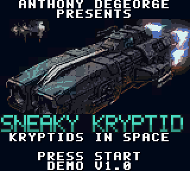
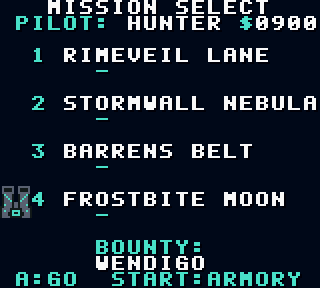
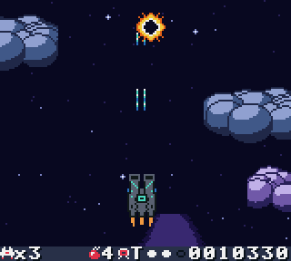
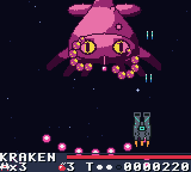
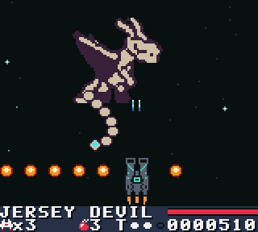
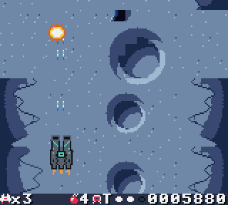
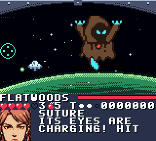
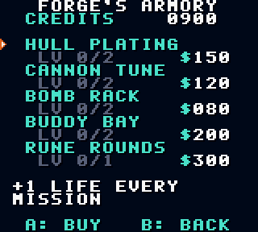

# Sneaky Kryptids

**Anthony DeGeorge presents *Sneaky Kryptids: Kryptids in Space***, a vertical space shooter for the
Game Boy Color from **Rejected By The Machines** (RBTM).

You fly the *Sneaky Kryptid*, a bounty-hunter ship, on contracts against legendary cryptids reborn
among the stars: the Space Kraken, the Thunderbird, the Jersey Devil, the Wendigo and the Flatwoods
Monster. Fly clean to bring the bounty in alive. Then a rival gang shows up, the guns go dead, and
the last mission is a run for your life.

### [▶ Play in your browser](https://ant-degeorge.github.io/SneakyKryptids-KryptidsinSpace/play/)

Touch controls on phones, keyboard on desktop. Progress saves in your browser.

| | | | |
|:---:|:---:|:---:|:---:|
|  |  |  |  |
| Title | Mission select | Stormwall Nebula | Space Kraken |
|  |  |  |  |
| Jersey Devil | Frostbite Moon | Flatwoods Monster (gun cam) | Forge's Armory |

## Features

- **Six missions:** four scrolling shooter stages, a first-person gun-cam mission and a no-guns escape run.
- **Bounties with consequences.** Your score decides how each boss fight ends: **captured** (triple
  pay), **killed** (double pay) or **escaped** (base pay).
- **Arcade: Endless Run.** Missions 1-4 in a loop with no continues, seven ships (one more unlocks for each story mission cleared) and a
  best score saved per difficulty.
- **Forge's Armory.** Spend your pay on hull plating, cannon tuning, bomb racks, buddy bays, Rune
  Rounds and weapon runes.
- **Weapons and wingmen.** Twin cannons, spread shot and homing wisps, each with three power levels.
  Rescue sleeping baby cryptids to fly as wingmen.
- **A recharging shield**, checkpoints, boss practice, a story told by the ship's crew and an ending
  that remembers how you played.
- **Color-blind friendly.** Hazards never rely on telling red from green; warnings use shape and
  blinking as well as colour, and there are no full-screen strobes.
- **Original four-channel soundtrack.**
- **Runs on real hardware** (tested on a ModRetro Chromatic) and in any Game Boy Color emulator.

## Difficulties

Three save slots, one per difficulty, each with its own missions, stars, high scores, credits and gear.

| | CADET (easy) | PILOT (medium) | HUNTER (hard) |
|---|---|---|---|
| Health | 5 hearts, 3 lives | 3 hearts, 3 lives | one hit per life, 3 lives |
| Firing | automatic | automatic | hold A |
| Bombs | 5 | 5 | 3 |
| Enemy fire | slow, sparse | faster, aimed shots | aimed bursts, rings and fans |
| Continues | unlimited | unlimited | 9-second prompt, score resets |
| Rating | 1-5 stars | 1-5 stars | rank D / C / B / A / S |

## Controls

| Button | Action |
|---|---|
| D-pad | Fly (gun cam: move the crosshair) |
| A | Fire on Hunter (Cadet and Pilot fire automatically) · Escape Run: dash |
| B | Kryptid Bomb · Escape Run: shield pulse |
| START | Pause · on the mission map: Forge's Armory |
| SELECT + A | On the mission map: practice the boss |
| SELECT + B | On the title screen: erase saves |

Browser keyboard: arrow keys, **X** = A, **Z** = B, **Enter** = START, **Shift** = SELECT.

## Downloads and standalone demos

| Game | Browser | ROM (`rom/`) |
|---|---|---|
| **Sneaky Kryptids** (full game) | [Play](https://ant-degeorge.github.io/SneakyKryptids-KryptidsinSpace/play/) | `sneaky_kryptid.gbc` |
| **Flatwoods Drift**, the gun-cam mission on its own | [Play](https://ant-degeorge.github.io/SneakyKryptids-KryptidsinSpace/flatwoods/) | `flatwoods_drift.gbc` |
| **Escape Run**, the no-guns mission on its own | [Play](https://ant-degeorge.github.io/SneakyKryptids-KryptidsinSpace/escape/) | `escape_run.gbc` |
| **The Tree Line**, an on-foot mission (preview) | | `tree_line.gbc` |

- Every ROM has a `_nosave` version for flash carts without save RAM.
  `sneaky_kryptid_unlocked.gbc` opens every mission from the start.
- ROMs are also on the [Releases](../../releases) page. Checksums are in `rom/SHA256SUMS.txt`.
- Emulators: SameBoy, Emulicious, BGB or mGBA in Game Boy Color mode. Game Boy Color only.
- Hardware: any flash cart that takes a 512 KB MBC5 ROM. Each demo keeps its own save block, so they
  can share a cart's save RAM with the full game.

**ModRetro Chromatic (ChroMagician):** C. MAGICIAN on → back up the cart → Write Homebrew →
`sneaky_kryptid.gbc` → verify → C. MAGICIAN off → power-cycle. If the cart refuses the save header,
use `sneaky_kryptid_nosave.gbc`.

## Building from source

Requires [GBDK-2020](https://github.com/gbdk-2020/gbdk-2020) 4.5.0. Generated art, music and dialog
are committed, so a normal build needs only GBDK.

```sh
make GBDK_HOME=/path/to/gbdk          # every ROM, written to build/
make GBDK_HOME=/path/to/gbdk flatwoods escape_demo treeline unlocked   # individual targets
```

On Windows, run `build.bat` (expects GBDK at `C:\gbdk`, or set `GBDK_HOME`). It builds the full game,
Flatwoods Drift and Escape Run.

- Don't use `make -j`: lcc writes intermediate files side by side. A clean build takes several minutes.
- To regenerate data after editing art, music or dialog (Python 3, Pillow, numpy):
  `make script`, `make music`, `make assets`, `make cockpit`, `make escape`, `make weaponfx`.
  Some source paintings used by `make assets` are not included in this repository.
- `make jukebox` builds a sound test ROM with every song and effect.

**Testing.** With `pip install pyboy`, the bots in `test/` play the game headlessly, for example
`python3 test/bot.py build/sneaky_kryptid.gbc pilot pro --stage 1`. `sh test/suite.sh ROM` runs every
mission on all three difficulties. `tools/cvd_check.py` checks the weapon colours against
colour-vision-deficiency simulations.

## Repository layout

| Path | Contents |
|---|---|
| `src/` | Game code (C, GBDK-2020): engine, missions, menus, saves |
| `src/studio_card/` | Rejected By The Machines studio card module |
| `tools/` | Python generators for sprites, scenery, bosses, music and dialog |
| `music/` | Soundtrack sources (hUGETracker `.uge`) |
| `art/`, `ref/` | Source art the generators read |
| `test/` | PyBoy test bots and a SameBoy harness |
| `rom/` | Prebuilt ROMs and checksums |
| `docs/` | GitHub Pages site: browser players and screenshots |
| `third_party/` | hUGEDriver sources |

## Credits

**Created by Anthony DeGeorge** · Rejected By The Machines.
Design, story, characters and music are original. Creature designs are from the KRYPTID-DEX.

Built with [GBDK-2020](https://github.com/gbdk-2020/gbdk-2020). Music plays through
[hUGEDriver](https://github.com/SuperDisk/hUGEDriver) (public domain). The browser player uses
[WasmBoy](https://github.com/torch2424/wasmboy) (GPL-3.0, license in `docs/play/vendor/`).

## License

© 2026 Anthony DeGeorge. All rights reserved. The ROMs are free to download and play for personal,
non-commercial use. See [LICENSE](LICENSE).

Questions or permission requests: SneakyKryptid@gmail.com
