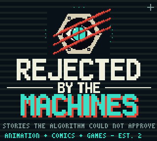
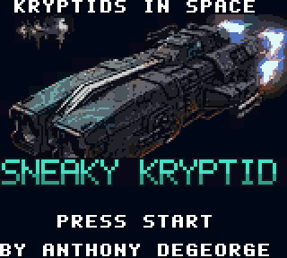
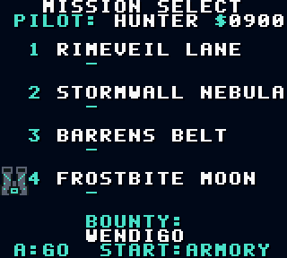
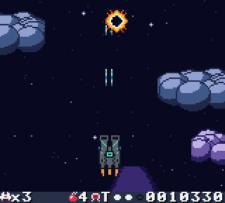
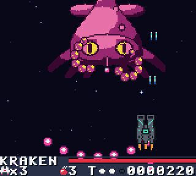
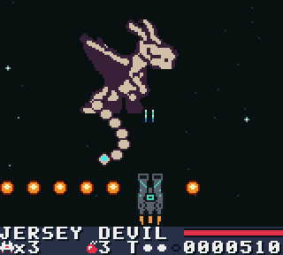

# Kryptids in Space: The Sneaky Kryptid — Game Boy Color demo

A vertical space shooter for the Game Boy Color. You fly the Sneaky Kryptid, a bounty-hunter
ship, on four cryptid contracts: the Space Kraken, the Thunderbird, the Jersey Devil and the
Wendigo. Fly clean and score high to bring the bounty in alive.

**Demo build.** Four full missions, two difficulties, saves, upgrades. Runs on real hardware
(ModRetro Chromatic, GBC, GBA) and any Game Boy Color emulator.

A game by Anthony DeGeorge · **Rejected By The Machines** · Kryptids in Space / Kryptid Prime Empire.

  
  

## Play it
- Download `sneaky_kryptid.gbc` from the [Releases](../../releases) page, or from `rom/` in this repo.
- Emulator: SameBoy, Emulicious, BGB or mGBA in Game Boy Color mode.
- Hardware: any flash cart that takes a 512 KB MBC5 ROM. Use `sneaky_kryptid_nosave.gbc` if
  your cart has no save RAM.

The game opens with the Rejected By The Machines studio card (A or START skips it).

## Pilots
Studio card → title → WHO'S FLYING? → mission map → briefing → mission → debrief.
Three save slots: two easy Cadet pilots and one Hunter. Each keeps its own missions, stars,
high scores, credits and gear.

| | CADET 1 / CADET 2 (easy) | HUNTER (hard) |
|---|---|---|
| Health | 5 hearts, 3 lives | one hit = one life, 3 lives |
| Firing | automatic | hold A |
| Bombs | 5 | 3 |
| Bullets | slower, fewer | aimed bursts, rings, fans |
| Continues | unlimited ("TRY AGAIN!") | 9-second prompt, score resets |
| Boss HP | Kraken 420, Thunderbird 560, Jersey Devil 620, Wendigo 680 | 820 / 1150 / 1250 / 1350, extra phases |
| Rating | 1-5 stars by hits | rank D/C/B/A/S by score |

## Controls
- D-pad: fly
- A: fire (Hunter; Cadet fires by itself)
- B: Kryptid Bomb (clears bullets, damages everything)
- START: pause
- Mission map: UP/DOWN picks an unlocked mission, A launches. **Hold SELECT while pressing A** to practice that mission's boss.
- Cutscenes: A next line, B or START skips

## Bounties: capture, kill or escape
Your score in the mission decides how the boss fight ends:
- **CAPTURED** (top score): Forge's rune net seals it in the hold. Triple pay.
- **KILLED** (good score): contract closed. Double pay.
- **ESCAPED** (low score): it breaks away. Base pay only.
Mid-bosses work the same way (captured or destroyed if you beat them, gone if the timer runs out).
Continues cost you: Hunter's bounty points reset, Cadet's are halved.
Bonus pay: +50 for a captured mid-boss (+25 destroyed), +50 for a no-hit mission.

## Shooting bullets
Your shots knock small enemy bullets out of the air (+10 each). Big orbs soak shots unless
you own Rune Rounds, which break them in two hits.

## Forge's Armory (START on the mission map)
Credits are saved per pilot. Gear stays bought.
| Item | Lv 1 | Lv 2 | Cost |
|---|---|---|---|
| Hull Plating | +1 life | +1 more | 150 / 350 |
| Cannon Tune | start at weapon level 2 | level 3 | 120 / 300 |
| Bomb Rack | +1 bomb | +1 more | 80 / 200 |
| Buddy Bay | room for 3 buddies | start with one | 200 / 400 |
| Rune Rounds | shots break big orbs | | 300 |

## Buddies
Each mission has a sleeping baby cryptid: kraken spawn, impundulu chick, pukwudgie, tatzelwurm pup.
Fly into it and it joins as a wingman that copies your moves and fires with you (up to 2, 3 with
the Buddy Bay). You lose one when you lose a life.

## Weapons
Capsules cycle T → S → H; grab the letter you want. Same letter again = level up (3 pips).
- **T** Twin cannons (L3 adds the prong cannons)
- **S** Spread (3 → 5 way)
- **H** Homing wisps (1 → 3)
- **B** bomb, **heart** (Cadet), **1** extra life (Hunter). Hunter extends at 30k and 80k.

## Missions
1. **Rimeveil Lane**: krakenlings (mini Krakens), gremlin skiffs, ice ring, mid-boss Nubs' scrap gunship, hauler convoy, wrecks → **Space Kraken** (a blinking marker shows tentacle slams).
2. **Stormwall Nebula**: Impundulu lightning birds, Lindworms (hit the head), thunderclouds that drop lightning columns, mid-boss **Mothman** → **Thunderbird** (bolts, feather fans, wind gusts, serpent summons, charge).
3. **Barrens Belt**: Pukwudgies (some climb out of the pines below; a WARN blinks first), Devil's eggs that burst, will-o'-the-wisps (shoot when lit), mid-boss **Nubs Mk II** → **Jersey Devil** (fire sweep, stomp rows with a gap, screech rings, vanish).
4. **Frostbite Moon**: bolted-down mine turrets, frost bats, Tatzelwurms (hit the cat face), ice-storm wind, mid-boss **Beast of Bray Road** (leaps between perches) → **Wendigo** (claw grabs with a marker, ice shard fans, howl rings with whiteout, bat summons, blizzard).

Creature art is redrawn from the KRYPTID-DEX sheets (ref/dex).

Every mission has checkpoints at the start, the mid-boss and the boss approach.
Clearing a mission unlocks the next; clearing mission 4 plays the ending.

## Story / crew
Crew: YETI (captain), FORGE (armorer, rune master), SUTURE (medic), ZANNAH (contract mistress), STATIC (navigator/pilot). Names live in `tools/gen_script.py`.
Edit there, then `python3 tools/gen_script.py` and rebuild.

## Building
Needs [GBDK-2020](https://github.com/gbdk-2020/gbdk-2020) 4.5.0. The generated sources
(art, music, dialog) are committed, so Python is only needed to change them.
- Linux/macOS/WSL: `make GBDK_HOME=/path/to/gbdk` → `build/sneaky_kryptid.gbc` and `build/sneaky_kryptid_nosave.gbc`
- Windows: `build.bat` (expects GBDK at `C:\gbdk`, or set `GBDK_HOME`)
- Regenerate data: `make script` (dialog, `tools/gen_script.py`), `make music` (`tools/gen_sound.py`),
  `make assets` (`tools/gen_assets.py`, Python 3 + Pillow + numpy). Crew portraits and the title art
  are converted from reference paintings that are not in this repo, so `make assets` needs them in `ref/`.

### Layout
| Path | What |
|---|---|
| `src/` | game code (GBDK C). `stage.c` engine, `s1.c`–`s4.c` mission logic, `scenes.c` menus/story/saves, `core.c` interrupts and loaders |
| `src/studio_card/` | Rejected By The Machines studio card module (owns the STAT vector; the game's raster split runs through `sc_stat_hook`) |
| `tools/` | Python generators: sprites, scenery, bosses, music, script |
| `ref/dex/` | creature sheets the enemies were redrawn from |
| `test/` | PyBoy bots (`bot.py`, `suite.sh`) and a SameBoy harness (`test/sameboy/`) |

## Testing
`pip install pyboy`, then `python3 test/bot.py build/sneaky_kryptid.gbc cadet|hunter kid|pro [seed] [--stage N] [--boss]`
plays a mission; `sh test/suite.sh build/sneaky_kryptid.gbc "1 2 3 4"` runs every mission in both modes.
PyBoy is not timing-accurate for the studio card's per-line effects; use SameBoy or Emulicious to judge it.

## Flashing a ModRetro Chromatic cart (ChroMagician)
C. MAGICIAN on → back up the cart → Write Homebrew → `sneaky_kryptid.gbc` → verify →
C. MAGICIAN off → power-cycle. Writing replaces the game on the cart.
If the cart refuses the save header, use `sneaky_kryptid_nosave.gbc` (no saves). The ROM is 512 KB, so the cart needs at least 512 KB of flash.

## Credits
Design, story and characters: Anthony DeGeorge / Rejected By The Machines.
Music is original. Built with GBDK-2020. Creature designs from the KRYPTID-DEX.
© 2026 Anthony DeGeorge. All rights reserved.
